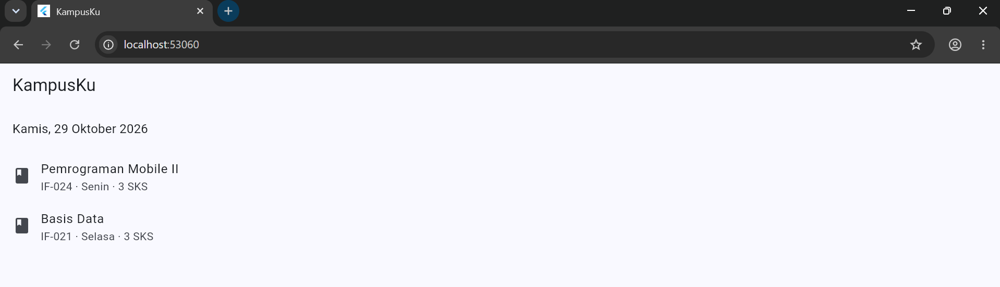
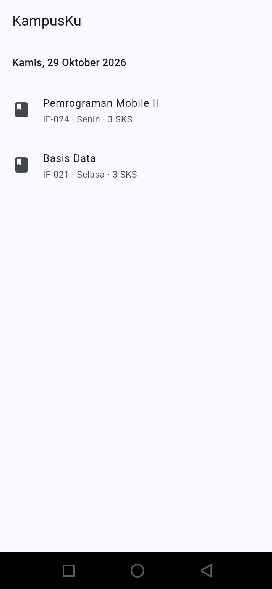

# KampusKu

Aplikasi awal KampusKu. Dibuat sebagai tugas Pertemuan 3 mata kuliah Pemrograman Mobile II , Semester Ganjil 2026/2027.

## Identitas

- Nama: Nabil Bulqini Rosanda
- NIM: 24552011332
- Program studi: Teknik Informatika, Universitas Teknologi Bandung

## Fitur

- Halaman beranda dengan AppBar bertuliskan KampusKu.
- Tanggal hari ini dalam bahasa Indonesia, diambil dari `DateTime.now()` dengan package `intl`.
- Daftar contoh mata kuliah yang menampilkan kode, nama, hari, dan jumlah SKS.

## Cara Menjalankan

```bash
flutter pub get
flutter run -d chrome
```

Application ID Android: `id.ac.utb.kampusku`

## Struktur Folder

```
lib/
├── main.dart              # titik masuk aplikasi
├── app.dart               # konfigurasi MaterialApp dan tema
├── models/
│   └── mata_kuliah.dart   # model data mata kuliah
├── screens/
│   └── beranda_screen.dart # halaman beranda
├── widgets/               # komponen yang bisa dipakai ulang
├── services/              # akses data (belum digunakan)
├── providers/             # state management (pertemuan berikutnya)
└── utils/                 # konstanta dan fungsi bantuan
```

## Screenshot

### Google Chrome



### Android



## Dependensi

- `intl` untuk format tanggal dalam bahasa Indonesia
